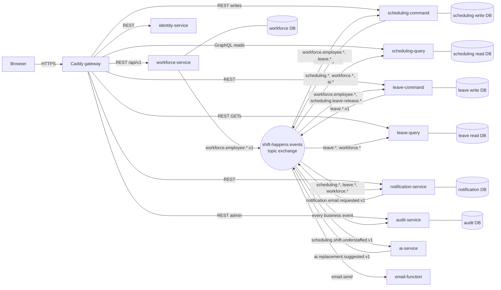
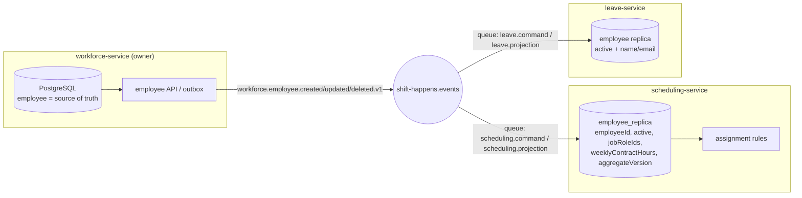
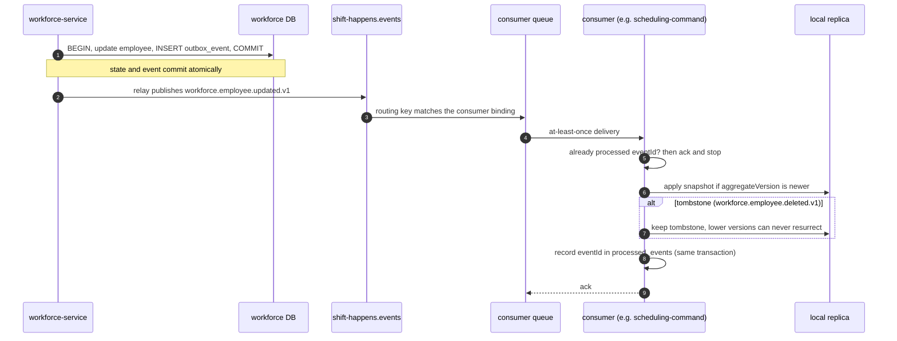

# Asynchronous services and local replicas

This document describes the runtime model that makes the services independent: every service owns its
database, services never call each other synchronously, and data another service needs is copied from
events. The diagrams are derived from the code in `services/*/infrastructure/messaging` and the rules in
[`contracts/README.md`](../../contracts/README.md) and [architecture.md](../architecture.md) §4.

## 1. Ownership: one writer, many readers

| Data | Owner (only writer) | Local copies |
|---|---|---|
| Accounts, password hashes, OIDC links, JWT keys | identity-service | — |
| Employees, contracts, departments, job roles, locations | workforce-service | scheduling-command, scheduling-query, leave-command, leave-query, notification-service |
| Shifts, required roles, assignments, approvals, swaps | scheduling-command | scheduling-query (Mongo read model) |
| Leave types, requests, approvals, ledger, saga state | leave-command | leave-query (Mongo read model) |
| Replacement suggestions | ai-service | scheduling-query (suggestions in the shift document) |
| In-app notifications | notification-service | — |
| Event history | audit-service | — |

A copy is a **replica**, not a shared table: only the owner accepts writes, and a replica is rebuilt
from events. Scheduling validates an assignment against its employee replica and never asks Workforce
whether the employee exists ([`EmployeeReplicaIT`](../../services/scheduling-service/src/test/java/dk/ek/shift_happens/scheduling/EmployeeReplicaIT.java)).

## 2. High-level asynchronous topology



There is deliberately **no arrow from one service to another service's API**. The only synchronous
service-to-service call is `ai-service → Ollama` (the external model), and `email-function → SMTP`.

### The same data, one owner and several copies



Only Workforce writes the employee row. Scheduling and Leave apply snapshots at their own pace; there is
no edge from Scheduling back to Workforce, by design.

## 3. Replica pattern (event-carried state transfer)

Workforce publishes full snapshots, not deltas, so a consumer can apply an event without asking for the
rest of the entity. Deletes are tombstones.



Properties that make the copy safe:

- **Idempotent consumers**: `processed_events`/`processed_event` stores the `eventId` in the same
  transaction as the replica change, so a redelivery is a no-op.
- **Commutative handlers**: the highest `aggregateVersion` wins. A late `updated.v1` with a lower
  version cannot overwrite a newer snapshot; a tombstone wins over lower versions.
- **Snapshots, not patches**: the event body is the full entity (`contracts/events/payloads/*.schema.json`).
- **At-least-once, never lost**: producer state and outbox row are one transaction; the relay retries
  until the broker accepts the publish.

## 4. What independence buys (and costs)

| Property | Consequence |
|---|---|
| A consumer is down | Its queue keeps the events; when it restarts it drains and catches up. Other services keep working. |
| A producer is down | Its own writes stop; consumers keep serving their last replica. No timeout chain. |
| A consumer has stale data | Eventual consistency, normally under a second locally; the UI may need a refresh while a projection catches up. |
| A contract changes | The producer and every consumer are updated in one contract-first pull request; replicas are rebuilt from the event stream. |
| A replica is corrupted | Scheduling/leave read models can be rebuilt (`PROJECTION_REBUILD_ON_START=true`); replicas are derived data. |

The cost is explicit: no distributed transaction, so business flows that span two services use a saga
(see [CQRS and the leave saga](cqrs-and-saga.md)) and every consumer must be idempotent.

## 5. How to observe the asynchrony

```bash
# Is a consumer behind? Look at queue depth and consumers.
curl -u shift:shift_dev http://localhost:15672/api/queues/%2Fshift-happens

# Stop a consumer, publish a business event, watch ready messages grow, restart and watch them drain.
docker compose -f docker-compose.microservices.yml --profile app stop audit-service
# ... create/update an employee through the API or UI ...
docker compose -f docker-compose.microservices.yml --profile app start audit-service
```

See [observability, DLQ and recovery](observability-dlq-recovery.md) for the full runbook and captured
evidence.
