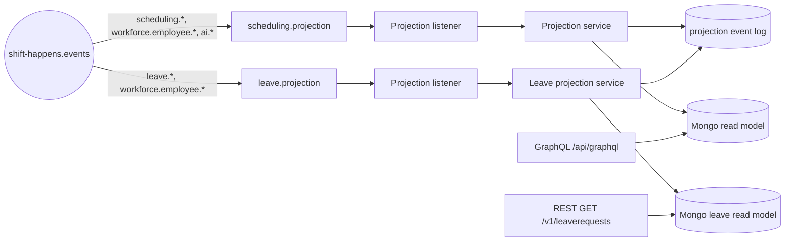
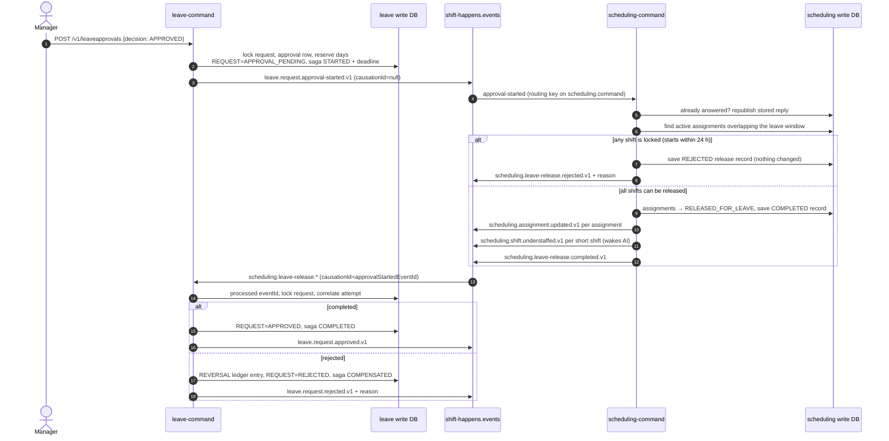
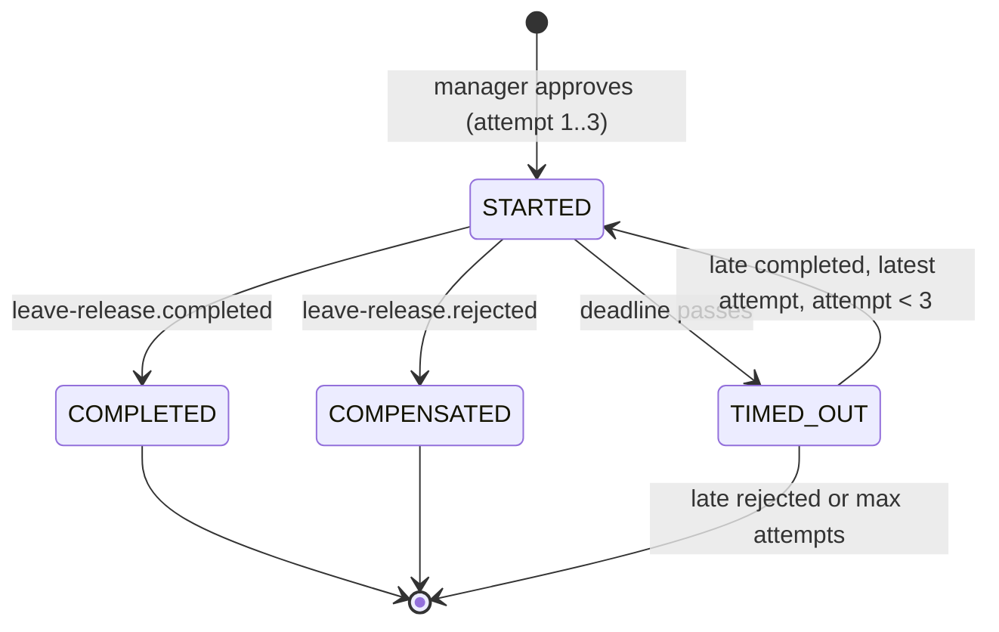

# CQRS in Scheduling and Leave

Scheduling and Leave are each **one codebase deployed twice**, selected by `APP_ROLE=command|query`
([architecture.md](../architecture.md) §4, [ADR 0003](../adr/0003-graphql-on-scheduling-read-side.md)).
This document shows the write path, the read path, what keeps them consistent, and where the saga fits.

> **Important distinction:** the read database is **not** updated by a saga. It is updated by the
> transactional outbox → RabbitMQ → idempotent projection. The saga is a separate mechanism for a
> business transaction that spans Leave and Scheduling (approving leave releases shifts).

## 1. The two roles

| | Command role | Query role |
|---|---|---|
| Profile | `APP_ROLE=command` | `APP_ROLE=query` |
| Storage | PostgreSQL (`scheduling-write-db`, `leave-write-db`) | MongoDB (`scheduling-read-db`, `leave-read-db`) |
| API | REST writes (`/v1/...`), `202 Accepted` | GraphQL (Scheduling) or REST GETs (Leave) |
| Writes | domain rules, ledger, saga state, outbox | none |
| Reads | none served to the browser | all schedule/leave reads |
| Scaling | transactional, one writer per aggregate | horizontally scalable, read-only |

`application-query.yml` excludes JPA/Postgres and `application-command.yml` has no Mongo client, so a
query replica physically cannot write the command database.

## 2. Write path: state and event in one transaction

```mermaid
flowchart LR
    C[Browser] -->|POST /api/v1/...| GW[Gateway]
    GW -->|/api/v1/shifts*| API[Command REST controller]
    API --> APP[Application service<br/>@Transactional]
    APP --> DOM[Domain rules]
    APP --> PG[(PostgreSQL<br/>aggregate + outbox_event)]
    PG -. same transaction .- OUT[outbox_event row]
    OUT --> REL[OutboxRelay<br/>@Scheduled every 2 s]
    REL -->|publish unpublished rows| EX((shift-happens.events))
    API -->|202 + resource| C
```

The use case writes the aggregate and the event row in one local transaction. The relay is the only
publisher; if the broker is down the row stays unpublished and is retried on the next tick (at-least-once).
The browser gets `202 Accepted` with the resource id because projections are asynchronous.

## 3. Read path: outbox → queue → projection



Each projection applies these rules in order:

1. **Redelivery** — if `eventId` is already in the processed log, skip (the log entry and the read-model
   change commit together).
2. **Version rule** — apply the snapshot only if `aggregateVersion` is newer than the stored document;
   tombstone beats lower versions and can never be cleared by a late update.
3. **Projection log** — append the event to the projection event store; `PROJECTION_REBUILD_ON_START=true`
   replays it into empty collections. This is the rebuild path, not a backup restore.
4. **Ack** — only after the transaction commits; a failure goes through the retry/DLX policy.

### Freshness

The read model is **eventually consistent**: relay delay (default 2 s), broker hop, projection
transaction. A read right after a write may not see it. The UI handles this by refetching/polling and by
showing the command's `202` resource until the read side catches up. There is no synchronous
"read-your-writes" guarantee across the CQRS boundary.

### Why a read model at all?

The measured answer is in [cqrs-read-model.md](../measurements/cqrs-read-model.md): at this data volume
Mongo is *not* faster than PostgreSQL with joins. CQRS is justified by **availability and independent
scaling** — the query role has no connection to the write database, so schedule reads keep working when
the command role is down — not by latency.

## 4. The leave-approval saga (Leave orchestrates, Scheduling participates)

This is the only business transaction that genuinely spans two services. Scheduling's own swap approval
is a local transaction (ADR 0002), which is why it is not a saga.



### Who guarantees what

| Guarantee | Mechanism |
|---|---|
| Exactly one decision per request | The request row is locked first; a reply, timeout and cancel serialise on it |
| A reply reaches the right attempt | `causationId` = `eventId` of that attempt's `approval-started`; `LeaveApprovalSaga` correlates it |
| Redelivered reply is harmless | `processed_events` in the same transaction; duplicate replies are ignored |
| Half-release is impossible | Scheduling checks **all** overlapping shifts for a lock before changing any; one locked shift rejects the whole release |
| A lost reply does not hang | `SagaTimeoutJob` compensates attempts past their deadline (`SAGA_TIMEOUT`, default 5 min) |
| A late success after a timeout | A late `completed` for the latest timed-out attempt starts retry 2 or 3; otherwise it is ignored with a warning |
| Compensation is real | A `REVERSAL` entry in the immutable ledger gives the days back; the request becomes `REJECTED` with a reason |

### Saga state machine



The rules are plain Java in
[`LeaveApprovalSaga`](../../services/leave-service/src/main/java/dk/ek/shift_happens/leave/domain/LeaveApprovalSaga.java)
(`reactTo`), so they are unit-tested without Spring. The orchestration is in
[`LeaveApprovalSagaService`](../../services/leave-service/src/main/java/dk/ek/shift_happens/leave/application/LeaveApprovalSagaService.java);
the Scheduling half is
[`LeaveReleaseService`](../../services/scheduling-service/src/main/java/dk/ek/shift_happens/scheduling/application/LeaveReleaseService.java).

**Known limitation:** if Scheduling released the shifts but every reply is lost and all three attempts
time out, Leave compensates and the request stays `REJECTED` while the assignments remain
`RELEASED_FOR_LEAVE`. The code logs this explicitly ("the released assignments need manual follow-up").
It is the honest cost of compensation over a distributed transaction.

## 5. Reading the code

| Concern | File |
|---|---|
| Command profile and write API | `services/scheduling-service/src/main/java/.../api`, `application` |
| Outbox relay | `.../infrastructure/messaging/OutboxRelay.java` |
| Projection listener and rules | `.../infrastructure/readmodel/SchedulingProjectionListener.java`, `application/SchedulingProjectionService.java` |
| Rebuild | `.../infrastructure/readmodel/ProjectionRebuildRunner.java` |
| Leave saga | `services/leave-service/src/main/java/.../application/LeaveApprovalSagaService.java`, `domain/LeaveApprovalSaga.java` |
| Saga timeout | `.../application/SagaTimeoutJob.java` |
| Cooperation tests | `tests/cooperation/.../LeaveApprovalSagaIT.java`, `services/scheduling-service/.../LeaveReleaseIT.java` |
