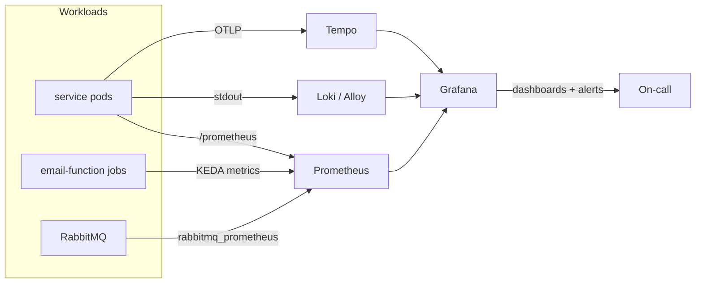
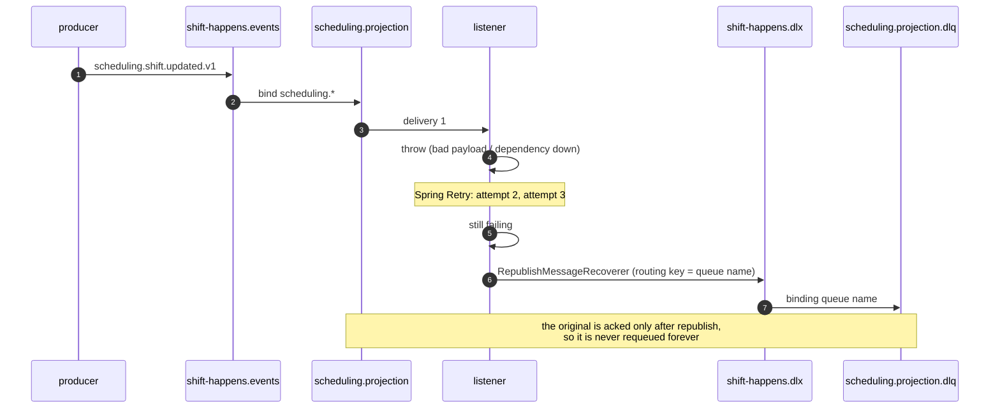
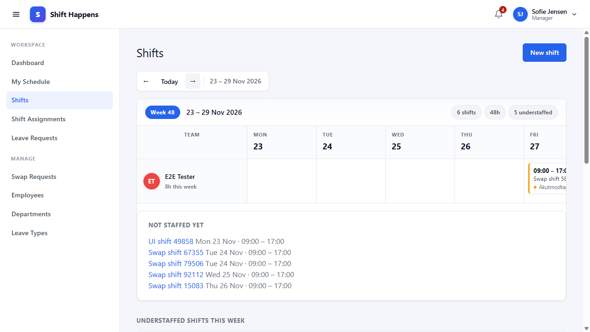
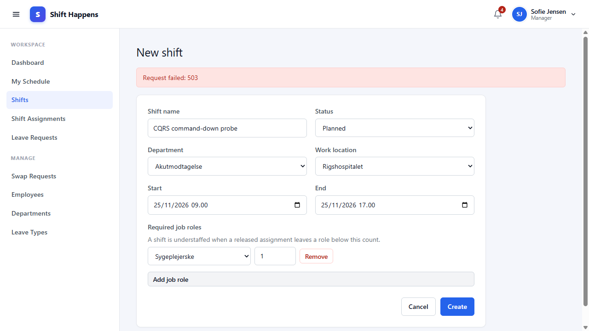
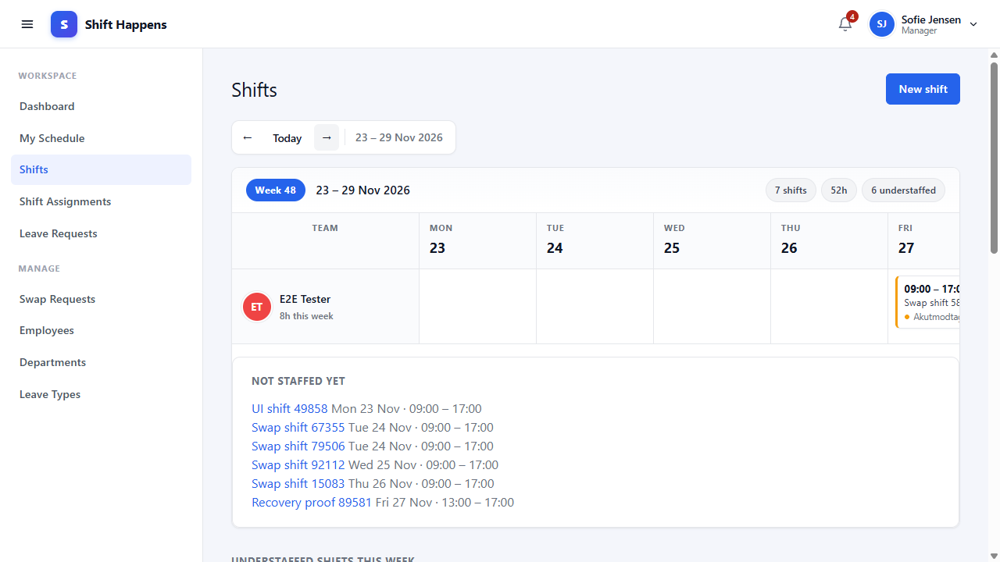
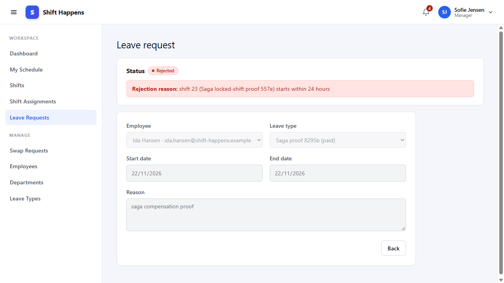
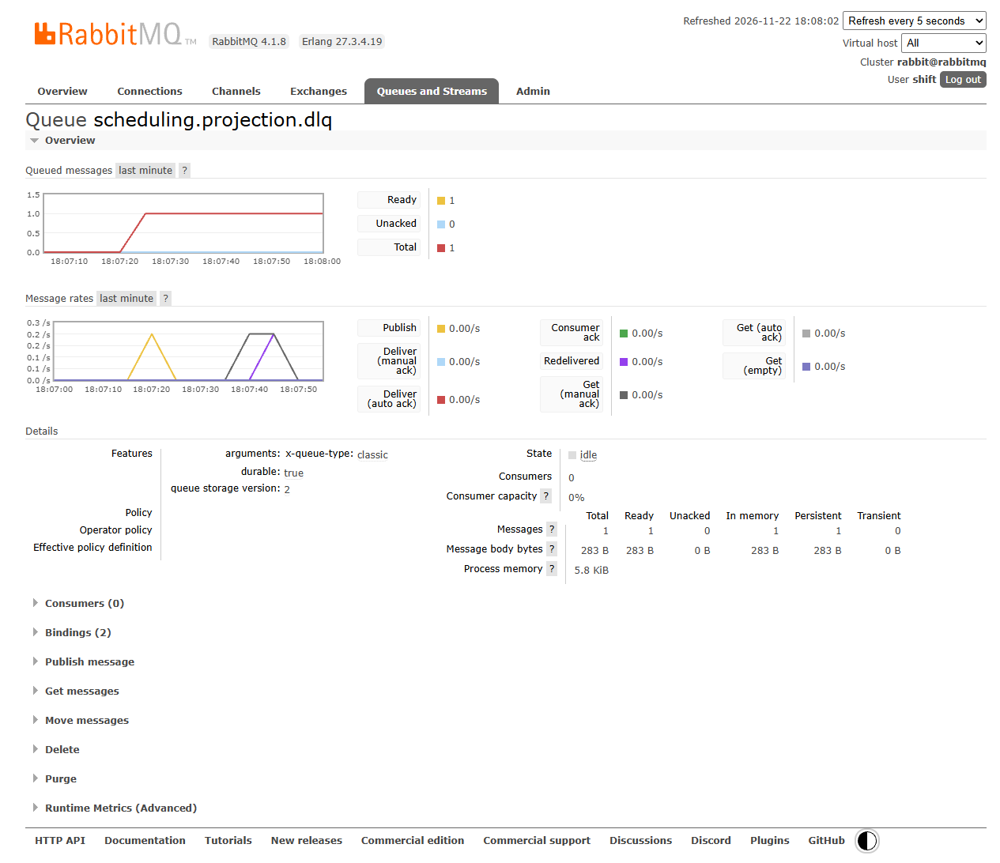
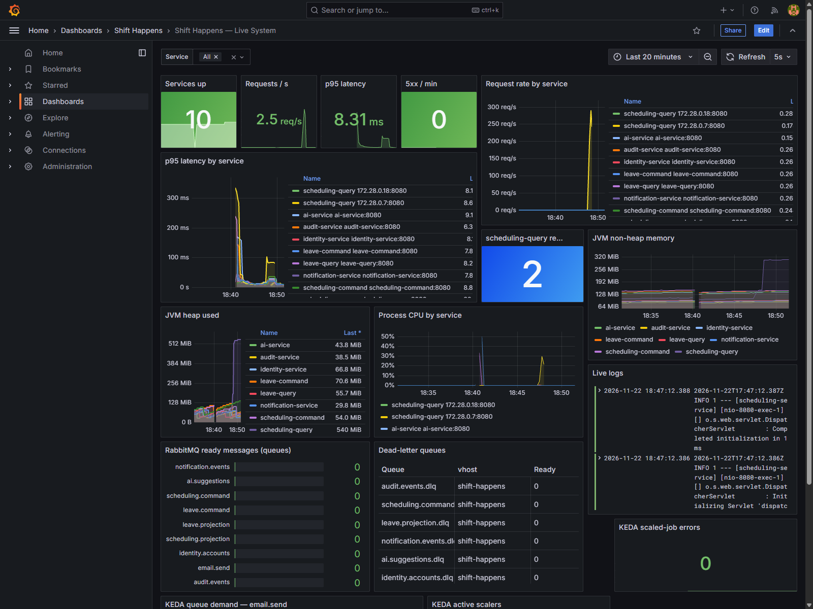
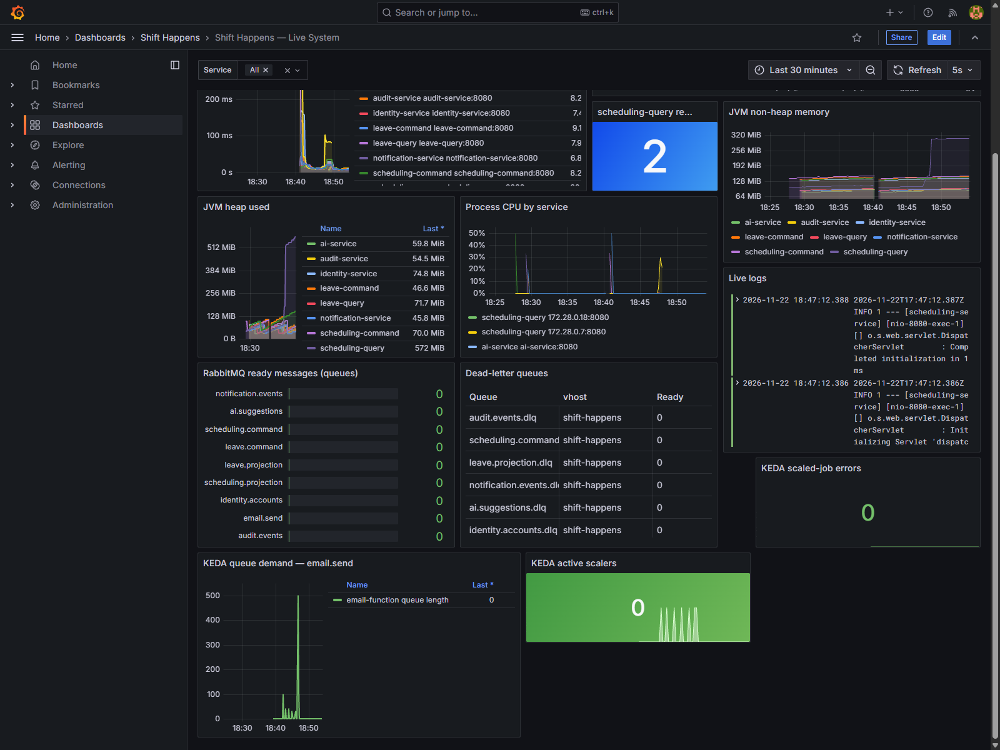
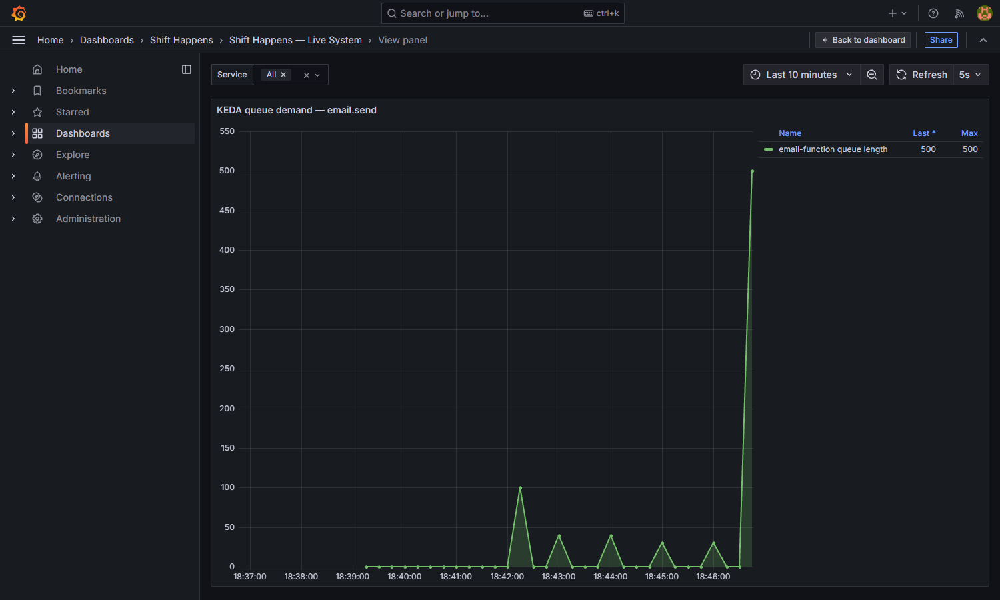

# Observability, DLQ and recovery

The local Compose profile now runs **Prometheus, Loki, Promtail and Grafana** alongside the services.
Every service exposes Micrometer metrics at `/prometheus`, RabbitMQ exposes the queue/DLQ plugin at
`/metrics/per-object`, and Grafana is provisioned with the **Shift Happens — Live System** dashboard.
KEDA is installed in the Docker Desktop Kubernetes cluster and its operator metrics are scraped into the
same Prometheus. Tempo/traces and the Kubernetes deployment of the observability stack remain future work.

## 1. Current local observability (Docker Compose)

```mermaid
flowchart LR
    subgraph Services[Application services]
        S1[scheduling-command]
        S2[scheduling-query]
        S3[leave-command]
        S4[workforce]
        S5[notification]
        S6[audit]
        S7[ai]
        S8[identity]
    end
    S1 -->|/prometheus| PROM[Prometheus]
    S2 --> PROM
    S3 --> PROM
    S4 --> PROM
    S5 --> PROM
    S6 --> PROM
    S7 --> PROM
    S8 --> PROM
    RMQ[RabbitMQ<br/>management + Prometheus plugin] -->|/metrics/per-object| PROM
    CAD[cAdvisor] -->|container metrics| PROM
    KEDA[KEDA operator<br/>NodePort 32073] -->|queue demand / errors| PROM
    S1 -->|stdout, [correlationId]| PROMPTAIL[Promtail]
    S2 --> PROMPTAIL
    S3 --> PROMPTAIL
    S4 --> PROMPTAIL
    S5 --> PROMPTAIL
    S6 --> PROMPTAIL
    S7 --> PROMPTAIL
    S8 --> PROMPTAIL
    PROMPTAIL -->|push| LOKI[Loki]
    PROM --> GRAF[Grafana :3001]
    LOKI --> GRAF
    GRAF -->|dashboards| OPS[Operator]
    AUD[(audit DB)] -->|business history| OPS
```

| Signal | Source | Where to look now | Example use |
|---|---|---|---|
| Application logs | SLF4J stdout with `[correlationId]` | Grafana **Live logs**, or `docker logs <container>` | Follow one approval through Leave, Scheduling and Notification |
| Metrics | Spring Boot Actuator + Micrometer | <http://localhost:9090> (Prometheus), <http://localhost:3001> (Grafana) | RED metrics, JVM heap/CPU, per-replica split |
| Health | Actuator `GET /health` | `docker compose ps`, container healthchecks | Is a replica starting or unhealthy? |
| Queue depth / DLQ | RabbitMQ Prometheus plugin | Grafana **RabbitMQ ready messages** / **Dead-letter queues**, or <http://localhost:15672> | Is a consumer down or a poison message parked? |
| CPU / RAM | Process metrics (Java) and cAdvisor | Grafana **Process CPU** / **JVM heap** / **JVM non-heap** | Which replica is hot during a load test? |
| KEDA demand | KEDA operator metrics | Grafana **KEDA queue demand** / **KEDA active scalers** | Did the queue cross the ScaledJob threshold? |
| Business history | audit-service `audit_entry` | `GET /api/v1/auditlogs?correlationId=...` as Administrator | What happened, in order, for one user action? |
| Traces | OTel collector (OTLP 4317/4318) | `docker logs otel-collector` | Pipeline only; services do not export spans yet |

Grafana is provisioned from `docker/microservices/observability/grafana`; the dashboard UID is
`shift-happens-live`. Prometheus scrapes the query role through Docker DNS service discovery, so scaling
`scheduling-query` to two replicas produces two `instance` series automatically.

**cAdvisor caveat:** Docker Desktop's cAdvisor exposes host/cgroup series but not stable container names,
so the per-service CPU/RAM panels use the JVM **process** metrics from Micrometer. cAdvisor remains
scraped for host-level container metrics and works normally on a Linux node.

## 2. Target production Kubernetes stack

KEDA is now installed and the email ScaledJob is verified against real RabbitMQ/Mailpit. Prometheus,
Loki and Grafana still run in Compose for the demo; the target is to run the same images/manifests in
the cluster and add Tempo for traces.



| Dashboard | From | Alert example |
|---|---|---|
| RED per service | Actuator/Micrometer → Prometheus | 5xx rate > 1% for 5 min |
| Queue depth and DLQ size | RabbitMQ Prometheus plugin | `scheduling.projection.dlq > 0` |
| KEDA scale-out/errors | KEDA operator metrics | `keda_scaled_job_errors_total` increases |
| Saga health | Leave saga state/metrics | attempts stuck in `STARTED` longer than `SAGA_TIMEOUT` |
| LLM fallback rate | ai-service metrics | fallback ratio > 50% for 10 min |
| Resource use | JVM process + cAdvisor/kubelet | CPU throttling or heap pressure |

KEDA installation and the ScaledJob demo are documented in
[`kubernetes/autoscaling/README.md`](../../kubernetes/autoscaling/README.md). Ingress-nginx and a
Kubernetes Grafana stack are still P7.1/P7.4; the Compose stack is the working local proof.
Prometheus evaluates the alert rules in `docker/microservices/observability/alert-rules.yml`; delivering
notifications (Alertmanager/Grafana contact points) is still open.

## 3. Examples of using the current signals

```bash
# 0. Open the live dashboard (admin / admin locally; change GRAFANA_PASSWORD).
#    http://localhost:3001/d/shift-happens-live
#    Prometheus: http://localhost:9090

# 1. Follow one business action across services by its correlation id.
docker logs scheduling-command 2>&1 | Select-String 'c1d2e3f4'
docker logs leave-command     2>&1 | Select-String 'c1d2e3f4'
docker logs notification-service 2>&1 | Select-String 'c1d2e3f4'

# 2. Queue health (ready = waiting, unacked = delivered but not acked).
curl -u shift:shift_dev http://localhost:15672/api/queues/shift-happens
#    look at: name, messages_ready, messages_unacknowledged, consumers, message_stats.publish_details.rate

# 3. Is a container unhealthy?
docker compose -f docker-compose.microservices.yml --profile app ps
curl -k https://localhost:8443/health          # gateway health
docker exec shift-happens-microservices-scheduling-command-1 \
  wget -qO- http://localhost:8080/health

# 4. Resource snapshot while a load test runs.
docker stats --no-stream --format "table {{.Name}}\t{{.CPUPerc}}\t{{.MemUsage}}"

# 5. Stress the query role (optionally with two replicas) and watch Grafana.
docker compose -f docker-compose.microservices.yml --profile app up -d --scale scheduling-query=2
LOAD_REQUESTS=30000 LOAD_CONCURRENCY=60 node scripts/load-schedule.mjs

# 6. Stress the KEDA email ScaledJob (Kubernetes RabbitMQ, port-forward first).
kubectl -n shift-happens port-forward svc/rabbitmq 15672:15672
node scripts/keda-email-burst.mjs 500
kubectl -n shift-happens get jobs
```

Useful PromQL for ad-hoc exploration:

```promql
sum by (job) (rate(http_server_requests_seconds_count[1m]))                 # request rate
histogram_quantile(0.95, sum by (le, job) (rate(http_server_requests_seconds_bucket[2m])))
sum by (job) (process_cpu_usage)                                           # JVM process CPU
rabbitmq_queue_messages_ready{queue!~".*dlq"}                              # backlog
sum(increase(keda_scaled_job_errors_total[1h]))                            # KEDA errors
```

## 4. Dead-letter queue: how a poison message is parked

Every consumer declares one durable queue, `<queue>`, with `x-dead-letter-exchange = shift-happens.dlx`
and a matching `<queue>.dlq` bound to that DLX. The listener factory uses a stateless retry advice with
**three attempts**, `defaultRequeueRejected=false`, and a `RepublishMessageRecoverer` that republishes
with the queue name as routing key.



| Queue | Dead-letter queue | Retry policy |
|---|---|---|
| `scheduling.command` | `scheduling.command.dlq` | 3 attempts, then republish |
| `scheduling.projection` | `scheduling.projection.dlq` | 3 attempts, then republish |
| `leave.command` | `leave.command.dlq` | 3 attempts, then republish |
| `leave.projection` | `leave.projection.dlq` | 3 attempts, then republish |
| `notification.events` | `notification.events.dlq` | 3 attempts, 1 s/2 s backoff |
| `ai.suggestions` | `ai.suggestions.dlq` | 3 attempts |
| `audit.events` | `audit.events.dlq` | 3 attempts |
| `identity.accounts` | `identity.accounts.dlq` | 3 attempts |
| `email.send` (serverless) | `email.send.dlq` | 3 attempts, 1 s/2 s, then dead-letter |

### Operating a DLQ

```bash
# Inspect depth and get a sample message through the management API.
curl -u shift:shift_dev "http://localhost:15672/api/queues/%2Fshift-happens/scheduling.projection.dlq"
curl -u shift:shift_dev -X POST -H 'content-type: application/json' \
  -d '{"count":1,"ackmode":"ack_requeue_false","encoding":"auto"}' \
  "http://localhost:15672/api/queues/%2Fshift-happens/scheduling.projection.dlq/get"

# After fixing the cause, replay by publishing the body back to the original exchange/routing key.
# Consumers are idempotent, so a replay cannot apply an event twice.
```

A DLQ is **not** a retry queue. It is a parking lot with the original payload and headers, so the cause can
be diagnosed without losing the event. A malformed message stays there until someone fixes the consumer
or discards it with a recorded reason.

## 5. Staged failure, recovery and scaling

### 5.1 Read side survives a command-role crash (CQRS)

```bash
docker compose -f docker-compose.microservices.yml --profile app stop scheduling-command
# Open the Shifts page: GraphQL reads still answer from scheduling-query/Mongo.
# Try to create a shift: the write fails (gateway 502/503); no partial state is written.
docker compose -f docker-compose.microservices.yml --profile app start scheduling-command
# A write works again; the outbox relay publishes what was committed.
```

This is the behaviour measured in the CQRS document: the query role has no Postgres connection.

### 5.2 A consumer is down: events wait, then drain

```bash
docker compose -f docker-compose.microservices.yml --profile app stop audit-service
# Create or update an employee (REST/UI).
curl -u shift:shift_dev "http://localhost:15672/api/queues/%2Fshift-happens/audit.events"
# messages_ready grows; the producer and the rest of the system keep working.
docker compose -f docker-compose.microservices.yml --profile app start audit-service
# ready returns to 0 and the audit row appears.
```

### 5.3 Crash between publish and outbox update

The relay is at-least-once: a crash after `rabbitTemplate.send` and before `published_at` is committed
causes a redelivery after restart. Consumers ignore the duplicate `eventId`, so the visible state is
unchanged. This is the reason the consumer-side dedupe is not optional.

### 5.4 Scaling

Locally, scale a stateless query role manually and put it behind Caddy:

```bash
docker compose -f docker-compose.microservices.yml --profile app up -d --scale scheduling-query=2
docker stats --no-stream
# drive load through the gateway (GraphQL) and watch CPU split across both containers
docker compose -f docker-compose.microservices.yml --profile app up -d --scale scheduling-query=1
```

In Kubernetes the intended autoscaling is already declared, but **KEDA/ingress-nginx are not installed**
in the current Docker Desktop cluster (P7.1/P7.3), so an automatic "stress → new replica" demo is not
honest yet:

- `kubernetes/autoscaling/hpa.yaml`: CPU-based HPA for the stateless query roles and the frontend
  (metrics-server is installed; see `kubernetes/metrics-server/README.md`).
- `kubernetes/autoscaling/keda.yaml`: KEDA `ScaledObject` for a queue consumer and a `ScaledJob` for
  `email-function` (idle-exit so the Job completes).

The load script `scripts/load-schedule.mjs` drives authenticated GraphQL reads; use it for the local
two-replica demonstration and for the HPA/KEDA demos.

## 6. Captured evidence (2026-11-22, local Compose)

### 6.1 A consumer down, then drained

`audit-service` was stopped, then employee 15 was updated through the REST API. The other consumers
(scheduling/leave/notification) processed the same event; Audit's queue held it:

| Moment | `audit.events` ready | consumers |
|---|---|---|
| audit-service stopped, after the update | **1** | 0 |
| audit-service started again, after ~17 s | **0** | 1 |

No producer failed and no event was lost. The same pattern applies to every queue in the topology table.

### 6.2 Command role down, read side and write side

```bash
docker compose -f docker-compose.microservices.yml --profile app stop scheduling-command
```

- The **Shifts** page kept rendering from `scheduling-query`/Mongo: 6 shifts, 48 h, 5 understaffed, no error.
- Creating a shift returned **`Request failed: 503`**; the form stayed on `/shifts/new` and nothing was
  written, because the gateway had no command replica to route to.
- After `start scheduling-command`, the same form created a shift and it appeared in the next week.







### 6.3 Saga rejection and compensation (locked shift)

A published shift starting within 24 hours (`Saga locked-shift proof 557e`, shift 23) was assigned to
employee 4. A one-day leave request (18) was created, five days were granted, and the manager approved
it. Scheduling refused the release because the shift is locked; Leave compensated:

```
leave request 18 -> REJECTED
reason: shift 23 (Saga locked-shift proof 557e) starts within 24 hours
ledger: 18 RESERVATION -1.00 (balance 4.00) -> 19 REVERSAL +1.00 (balance 5.00)
audit (correlation 05193fe1-…): approval-started -> leave-release.rejected
        -> ledger.entry-recorded (reversal) -> leave.request.rejected
```



### 6.4 A poison message is parked in the DLQ

A valid envelope with an empty shift snapshot was published to `shift-happens.events` with routing key
`scheduling.shift.updated.v1`. The projection failed on `ShiftStatus.valueOf(null)`, retried three times,
and was republished to `scheduling.projection.dlq`:

```
scheduling.projection      ready=0 unacked=0 consumers=1
scheduling.projection.dlq  ready=1 unacked=0 consumers=0
headers: x-exception-message = "Name is null"
         x-original-exchange  = shift-happens.events
         x-original-routingKey= scheduling.shift.updated.v1
```



### 6.5 Correlation across services

The same saga correlation id appears in the logs of both services:

```
scheduling-command  [05193fe1-55e2-4449-8d4c-f7edd56d1590] Received leave.request.approval-started.v1 for aggregate 18 (v2)
leave-command       Received scheduling.leave-release.rejected.v1 for aggregate 18 (v1), correlation 05193fe1-55e2-4449-8d4c-f7edd56d1590
```

`GET /api/v1/auditlogs?correlationId=05193fe1-…` returns the same chain in business order:
`approval-started`, `leave-release.rejected`, `ledger.entry-recorded`, `request.rejected`.

### 6.6 Two query replicas under load

```bash
docker compose -f docker-compose.microservices.yml --profile app up -d --scale scheduling-query=2
LOAD_REQUESTS=10000 LOAD_CONCURRENCY=50 node scripts/load-schedule.mjs
docker stats --no-stream --format "{{.Name}} | {{.CPUPerc}} | {{.MemUsage}}"
```

| Measurement | Result |
|---|---|
| query replicas | 2 (`scheduling-query-1`, `scheduling-query-2`), both behind Caddy |
| requests / concurrency | 10,000 / 50 |
| throughput | **1,068 req/s** |
| errors | **0** |
| latency | p50 41 ms, p95 94 ms, p99 146 ms |
| CPU during the run | query-1 **559.67%**, query-2 **470.82%** (both replicas served traffic) |
| memory | ~860 MiB / ~824 MiB |
| second run (30,000 / 60, dashboard screenshot above) | **948.5 req/s**, p95 **143 ms**, p99 227 ms, 0 errors, 10 targets |

That is a **manual** query scale-out. Automatic KEDA queue scaling and the metrics-server/HPA path are
demonstrated in 6.7 and `kubernetes/metrics-server/README.md`.

### 6.7 Live Grafana + KEDA ScaledJob (after installing the stack)

The observability stack now runs in Compose. The dashboard shows 10 targets (two scheduling-query
replicas), request spikes, p95, JVM heap/CPU, queue depth and KEDA demand:





The KEDA ScaledJob was stress-tested with `scripts/keda-email-burst.mjs 500` against the cluster's
RabbitMQ. KEDA's queue metric reached **500**, it started **5 Jobs** (the configured maximum), Mailpit
received **500** messages, each Job completed in about **12 s**, and the queue returned to **0**:

```text
$ kubectl -n shift-happens get scaledjob email-function
NAME             MIN   MAX   READY   ACTIVE   TRIGGERS
email-function         5     True    True     rabbitmq

$ kubectl -n shift-happens get jobs          # during the burst
email-function-...   Running   0/1   ...     5 Jobs (maxReplicaCount)
$ kubectl -n shift-happens get jobs          # after ~12 s
email-function-...   Complete  1/1   ...     then TTL removes them
```



Two production bugs were found and fixed during the KEDA run:

1. the ScaledJob template did not pass `SMTP_HOST`/`SMTP_PORT` (jobs defaulted to `localhost:1025`), so
   the manifest now sets them;
2. `EMAIL_FUNCTION_EXIT_WHEN_IDLE=true` closed the Spring context but shutdown could block on the
   listener, leaving Kubernetes Jobs `Running`. The function now waits for three empty polls and calls
   `halt(0)`, so jobs complete and KEDA can scale down.

The Jobs appear as `Complete` in `kubectl -n shift-happens get jobs`; the manifest keeps three successful
Jobs and removes them after `ttlSecondsAfterFinished: 300`. The 500-message burst is the green spike in
the KEDA panel. KEDA itself scales the Job to zero when the queue is empty.

### 6.8 metrics-server and CPU HPA

Metrics-server was installed and verified (`kubectl top nodes` works). The frontend HPA is a real load
test, not just a manifest:

```text
$ kubectl -n shift-happens get hpa frontend
NAME       REFERENCE             TARGETS         MINPODS MAXPODS REPLICAS
frontend   Deployment/frontend   cpu: 1000%/60%  2       5       5

$ kubectl -n shift-happens get pods -l app=frontend
5 pods Running (two from minReplicas, three added by the load)

# load generator
kubectl -n shift-happens run load --image=williamyeh/hey:latest --restart=Never -- \
  -z 120s -c 100 http://frontend.shift-happens.svc.cluster.local
```

After the load stops, the HPA scales back to the two-replica minimum (60-second scale-down
stabilization). The full rules and installation note are in `kubernetes/autoscaling/hpa.yaml` and
`kubernetes/metrics-server/README.md`.

