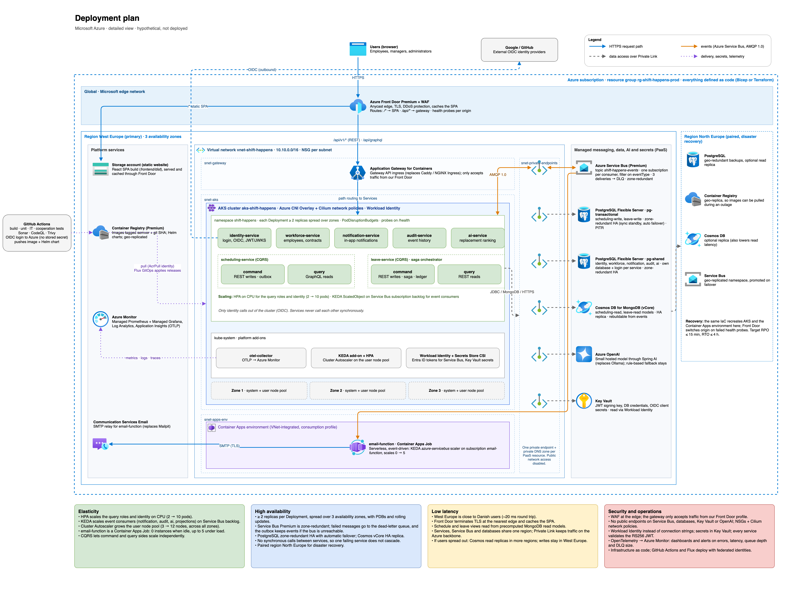
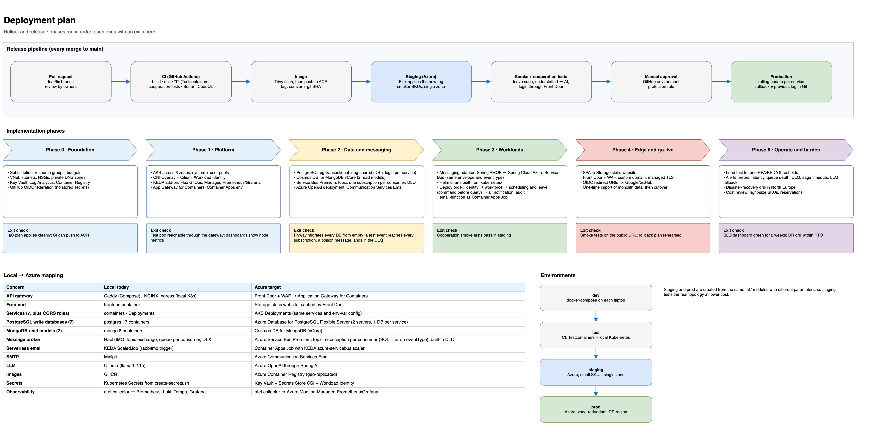

# 3.3. Cloud deployment plan

> Draft for the report. It replaces the current §3.3 text and the Railway paragraph under "Deployment
> Strategy". Figure 1 has two variants for the group to choose from:
> `docs/images/azure-deployment.png` (detailed) or `docs/images/azure-deployment-simple.png` (overview).
> Figure 2: `docs/images/azure-rollout-plan.png`. Editable sources: `docs/shift-happens-azure-deployment.drawio`
> (detailed + rollout page) and `docs/shift-happens-azure-deployment-simple.drawio`.

An actual cloud deployment is not required, so this section describes how Shift Happens would be deployed
to **Microsoft Azure**. We chose Azure because it offers a managed service for every part of our stack
(Kubernetes, PostgreSQL, a MongoDB-compatible database, messaging, a hosted LLM and monitoring), and because
Azure for Students gives credits without a credit card. The plan keeps the architecture from section 2
unchanged: the same seven microservices, the same CQRS split, the same event contracts. What changes is the
platform underneath, which moves from containers we run ourselves to Azure managed services.

*Figure 1: Hypothetical production deployment on Microsoft Azure.*

## 3.3.1. Selected services

| Concern | Local today | Azure target |
|---|---|---|
| Entry point | Caddy (Compose), NGINX Ingress (local Kubernetes) | Azure Front Door Premium with WAF → Application Gateway for Containers |
| Frontend | frontend container | Storage account static website, cached by Front Door |
| Microservices | Docker Desktop Kubernetes | Azure Kubernetes Service (AKS), nodes in 3 availability zones |
| Write databases (7) | `postgres:17` containers | Azure Database for PostgreSQL Flexible Server (2 servers, one database and login per service) |
| Read models (2) | `mongo:8` containers | Azure Cosmos DB for MongoDB (vCore) |
| Message broker | RabbitMQ | **Azure Service Bus Premium** (see 3.3.2) |
| Serverless function | KEDA `ScaledJob` | Azure Container Apps Job, scaled by KEDA on the Service Bus subscription |
| E-mail | Mailpit | Azure Communication Services Email (SMTP) |
| LLM | Ollama (`llama3.2:1b`) | Azure OpenAI through Spring AI |
| Images | GitHub Container Registry | Azure Container Registry (Premium, geo-replicated) |
| Secrets | Kubernetes Secrets | Azure Key Vault + Workload Identity |
| Observability | OTel Collector → Prometheus, Loki, Tempo, Grafana | OTel Collector → Azure Monitor (Managed Prometheus, Managed Grafana, Log Analytics, Application Insights) |

**Request path.** A user's browser connects to Azure Front Door, which terminates TLS at the nearest Microsoft
edge location. Front Door serves the React app from the static website and its edge cache, and forwards
`/api/v1/*` (REST) and `/api/graphql` to Application Gateway for Containers inside our virtual network. The
gateway routes by path to the Kubernetes Services in AKS, exactly as Caddy does locally. Like Caddy, it
contains no business logic.

**Network.** Everything regional runs in one virtual network with separate subnets for the gateway, AKS, the
Container Apps environment and the private endpoints. Service Bus, PostgreSQL, Cosmos DB, Azure OpenAI and
Key Vault have public network access disabled and are reached only through private endpoints. This mirrors
the isolated database networks we already use in Docker Compose.

## 3.3.2. Messaging: from RabbitMQ to Azure Service Bus

Azure has no managed RabbitMQ. We could run RabbitMQ ourselves inside AKS, but then we would still be
responsible for patching, clustering and backups of the broker. Instead, we would use **Azure Service Bus**,
Azure's managed message broker.

**The protocols are not compatible.** RabbitMQ speaks **AMQP 0-9-1**, while Service Bus speaks **AMQP 1.0**.
Despite the similar names, these are different protocols on the wire. Our services use Spring AMQP
(`RabbitTemplate`, `@RabbitListener`), which only speaks AMQP 0-9-1, so they cannot simply be pointed at
Service Bus by changing a connection string. The messaging code has to be rewritten with Spring Cloud Azure
Service Bus.

**The change stays in one layer.** Because of the layered structure (section 2), all RabbitMQ-specific code
lives in each service's `infrastructure/messaging` package: the outbox relay, the listeners and the topology
declarations. Today that is 13 classes in the five services that publish or consume events, plus the
email-function. The domain, the application layer, the REST/GraphQL APIs, the database schemas and the
outbox table do not change.

**The concepts map one to one:**

| RabbitMQ (today) | Azure Service Bus |
|---|---|
| Topic exchange `shift-happens.events` | Topic `shift-happens-events` |
| One durable queue per consumer | One subscription per consumer |
| Binding on routing key = `eventType` | Subscription filter on the `eventType` message property |
| Manual ack after the database commit | Peek-lock: the message is completed after the database commit |
| 3 attempts, then dead-letter exchange `shift-happens.dlx` | `MaxDeliveryCount = 3`, then the built-in dead-letter queue of the subscription |
| Deduplication by `eventId` in `processed_events` | Unchanged; Service Bus duplicate detection on `MessageId = eventId` is an extra guard |

**What does not change:** the event envelope, the `eventType` names and versions, and the JSON payload
schemas. Only the server and protocol section of the AsyncAPI contract changes. Service Bus does not
guarantee ordering between competing consumers unless sessions are used. We do not need sessions, because our
commutative message handlers already make the result independent of arrival order (highest
`aggregateVersion` wins, tombstones beat lower versions).

**Local development and tests.** Microsoft provides a Service Bus emulator as a container. It can replace
RabbitMQ in Docker Compose and in the Testcontainers-based integration and cooperation tests, so the code we
test locally and in CI is the same code that runs in Azure.

**Why accept the rewrite?** Service Bus is fully managed and zone-redundant in the Premium tier. It supports
private endpoints (Premium only) and Entra ID authentication through Workload Identity, so no passwords or
connection strings are stored. KEDA has a native Service Bus scaler. The alternative, RabbitMQ on AKS, needs
no code change but leaves us operating a stateful cluster. For a production system we prefer a one-time
change in a single layer over running the broker ourselves for good.

## 3.3.3. Scalability and availability

**Application level**
- Every Deployment runs at least two replicas spread over three availability zones, with PodDisruptionBudgets
  and readiness/liveness probes on `/health`. Losing one zone does not take a service down.
- The Horizontal Pod Autoscaler scales the query roles of Scheduling and Leave, and Identity, on CPU. KEDA
  scales event consumers on the backlog of their Service Bus subscription. The Cluster Autoscaler adds nodes
  when pods no longer fit.
- Because of CQRS, read traffic and write traffic scale independently.
- The email-function is a Container Apps Job that runs only while there are messages, so it scales to zero.
- No service calls another synchronously. If one service fails, events wait in its subscription and are
  processed when it recovers, without cascading failures.

**Database and messaging level**
- PostgreSQL Flexible Server runs with zone-redundant high availability: a synchronous standby in another
  zone with automatic failover, plus point-in-time restore. The two busiest write databases
  (scheduling-write, leave-write) get their own server. The five smaller ones share a second server, but each
  has its own database and login, so database-per-service still holds.
- Cosmos DB for MongoDB (vCore) runs with a high-availability replica. The read models can always be rebuilt
  from events, so losing them never loses data.
- Service Bus Premium is zone-redundant. If it is unreachable, the transactional outbox keeps the events in
  PostgreSQL and publishes them later.
- **Disaster recovery:** North Europe is the paired region. It holds geo-redundant database backups, a
  geo-replica of the container registry and a geo-replicated Service Bus namespace. The same infrastructure
  code can recreate the cluster there, and Front Door switches origin when health probes fail.

**Latency.** West Europe is close to our Danish users. Front Door serves the frontend from edge locations,
and UI reads come from pre-computed MongoDB read models. Services, broker and databases share one region and
one network, so no request crosses regions. If users later spread geographically, Cosmos DB can add read
replicas in more regions while writes stay in West Europe.

## 3.3.4. Security and data management
- Front Door's WAF filters traffic at the edge. The gateway only accepts traffic from our own Front Door
  profile.
- No database, broker, Key Vault or Azure OpenAI endpoint is reachable from the internet. Network security
  groups and Kubernetes network policies limit traffic between subnets and pods.
- Services authenticate to Azure with **Workload Identity** (Entra ID tokens), not stored passwords. The
  remaining secrets (JWT signing key, database credentials, OIDC client secrets) live in Key Vault and are
  mounted into pods by the Secrets Store CSI driver.
- Every service still validates the identity service's RS256 JWT itself.
- Data at rest is encrypted by the managed services. Backups use point-in-time restore for PostgreSQL. The
  leave ledger and audit history stay immutable as described in section 2.4.

## 3.3.5. Deployment and release approach

*Figure 2: Release pipeline, implementation phases and environments.*

- **Infrastructure as code.** All Azure resources are defined in Bicep or Terraform. Staging and production
  come from the same modules with different parameters (staging uses smaller SKUs in a single zone).
- **Release pipeline.** The CI from section 3.2.2 stays the same. After the tests and the Trivy scan, GitHub
  Actions pushes the image to Azure Container Registry, logging in with OIDC federation (no stored Azure
  secret). Flux (GitOps) in AKS deploys the new image tag to staging. Smoke and cooperation tests run there
  (leave saga, understaffed shift → AI suggestion). After a manual approval, the same tag is rolled out to
  production with rolling updates. A rollback means reverting the tag in Git.
- **Versioning.** Images are tagged with semver and git SHA, never `latest`. Flyway migrations run at
  startup and are forward-only (section 11).
- **Implementation phases** (Figure 2): foundation (network, Key Vault, registry) → platform (AKS, gateway,
  monitoring) → data and messaging (PostgreSQL, Cosmos DB, Service Bus) → workloads (including the messaging
  adapter rewrite) → edge and go-live (Front Door, domain, data import from the monolith) → operate and harden
  (load tests, alerts, disaster-recovery drill). Each phase ends with an exit check before the next starts.

## 3.3.6. Pricing strategy
- **Start small.** Azure for Students credits cover a demo. Staging uses burstable database tiers and a
  single zone. Low-traffic services (Audit, AI) get small resource requests.
- **Scale to zero where possible.** The email-function costs nothing when idle. AKS autoscaling removes
  nodes at night and on weekends, when shift planning is quiet.
- **Pay per use for the LLM.** At our volume, a hosted model billed per token is far cheaper than a GPU node
  running Ollama around the clock.
- **Know the big items.** The always-on costs are the AKS nodes, the two zone-redundant PostgreSQL servers,
  and Service Bus Premium, which is billed per messaging unit. Staging can use the Service Bus Standard tier
  (no private endpoints) to save money. In production, reserved instances for nodes and databases lower the
  price once the load is known. Azure Cost Management budgets alert before a limit is reached.

## 3.3.7. Architectural trade-offs

| Decision | Alternative | Why we chose it |
|---|---|---|
| Azure Service Bus | RabbitMQ in AKS | Managed, zone-redundant, private endpoints, no stored credentials. The cost is a rewrite of the AMQP 0-9-1 messaging adapter to AMQP 1.0, contained in `infrastructure/messaging` (3.3.2) |
| AKS | Azure Container Apps for everything | AKS matches our local Kubernetes manifests one to one and supports HPA, KEDA and network policies. Container Apps is simpler but would mean a second deployment model |
| Container Apps Job for the email-function | Azure Functions | Same container image as today and a native KEDA trigger. Functions would require rewriting the worker into the Functions programming model |
| Two PostgreSQL servers | One server per service | Seven HA servers would cost several times as much. Separate databases and logins still keep data ownership per service |
| Cosmos DB for MongoDB | MongoDB Atlas | Stays inside the Azure network with private endpoints and one bill. Atlas would also work, since the read models are rebuildable |
| Azure OpenAI | Ollama on a GPU node pool | Pay per use and no GPU to manage. The AI service keeps its rule-based fallback and validates the model output |
| One primary region + paired DR region | Active-active in several regions | Our users are in Denmark. Multi-region writes would add consistency problems we do not need |
