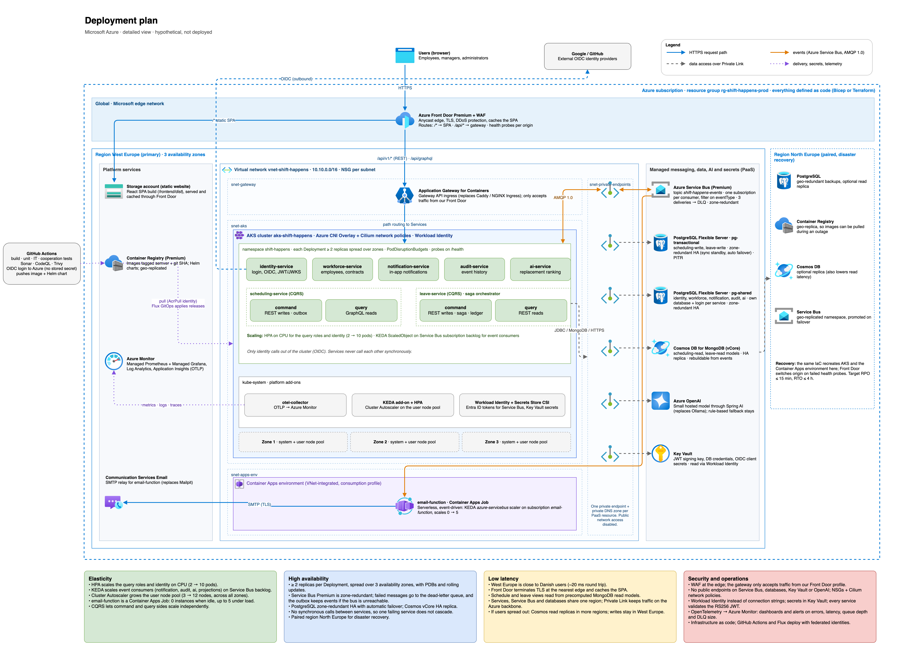

# Figure text: detailed deployment diagram

> Text to accompany the detailed diagram (`docs/images/azure-deployment.png`) in report section 3.3.
> Use it under the figure if the group picks the detailed variant. It describes what the figure shows; the
> reasoning behind the choices is in `docs/report-3.3-cloud-deployment-plan.md`.

*Figure 1: Deployment plan on Microsoft Azure, detailed view (hypothetical, not deployed).*

**How to read the figure.** The boxes are nested the way the resources are in Azure: one subscription
contains a global edge layer, the primary region West Europe and the paired region North Europe. Inside the
primary region, a virtual network is split into subnets. The line types show what flows between the boxes:
blue lines are HTTPS requests, orange lines are events on Azure Service Bus (AMQP 1.0), grey dashed lines are
data access through private endpoints, and purple dotted lines are delivery, secrets and telemetry.

**1. Entry point.** Users reach the system through **Azure Front Door** with a web application firewall
(WAF). Front Door terminates TLS at the nearest Microsoft edge location and splits the traffic by path.
Requests for the frontend (`/*`) go to a **storage account** that hosts the React build as a static website,
and Front Door caches the files at the edge. API requests (`/api/v1/*` for REST, `/api/graphql` for GraphQL)
go to **Application Gateway for Containers**, which takes the role Caddy has in Docker Compose: it routes by
path to the right service and contains no business logic.

**2. The AKS cluster.** All seven microservices run in **Azure Kubernetes Service**, in the namespace
`shift-happens`. Scheduling and Leave are drawn as pairs because they are deployed twice, once as the command
side (REST writes and outbox) and once as the query side (GraphQL and REST reads), and each side scales on its
own. Every Deployment has at least two replicas spread across the cluster's three availability zones, shown
as the three zone boxes at the bottom of the cluster. The `kube-system` row holds the platform add-ons: the
OpenTelemetry Collector, KEDA with the Horizontal Pod Autoscaler and Cluster Autoscaler, and Workload
Identity, which gives each service an Entra ID identity instead of stored passwords. The only connection that
leaves the cluster towards the internet is the identity service's OIDC login with Google and GitHub. Services
never call each other directly.

**3. Events and the serverless function.** The orange line shows how services communicate: they publish
events through their transactional outbox to **Azure Service Bus**, and each consumer reads from its own
subscription on the `shift-happens-events` topic. A message that fails three times is moved to the
subscription's dead-letter queue. The **email-function** runs in a separate **Container Apps environment** as
a Container Apps Job. KEDA starts it only when its subscription has messages, so it scales from zero to five
instances and back. It delivers e-mail through **Azure Communication Services**, which replaces Mailpit.

**4. Data, AI and secrets.** The right-hand column holds the managed services. None of them has a public
endpoint. The cluster reaches each one through its own **private endpoint**, shown as the column of
private-endpoint icons inside the virtual network.
- **Azure Service Bus Premium:** the event broker described above.
- **Two PostgreSQL Flexible Servers:** `pg-transactional` holds the busy write databases of Scheduling and
  Leave, and `pg-shared` holds the databases of Identity, Workforce, Notification, Audit and AI. Each service
  still has its own database and login. Both servers run with zone-redundant high availability.
- **Cosmos DB for MongoDB (vCore):** holds the two read models, which can always be rebuilt from events.
- **Azure OpenAI:** replaces the local Ollama model for replacement suggestions. The AI service keeps its
  rule-based fallback.
- **Key Vault:** stores the JWT signing key, database credentials and OIDC client secrets.

**5. Platform services.** The left-hand column holds the services that support the system but are not part of
a request.
- **Delivery:** GitHub Actions builds, tests and scans each image, then pushes it to **Azure Container
  Registry**. Flux inside the cluster deploys the new version.
- **Monitoring:** the OpenTelemetry Collector sends metrics, logs and traces to **Azure Monitor**, with
  Managed Prometheus and Managed Grafana for dashboards.

**6. Disaster recovery.** **North Europe**, the paired region, holds geo-redundant PostgreSQL backups, a
replica of the container registry, an optional Cosmos DB replica and a geo-replicated Service Bus namespace.
If West Europe fails, the same infrastructure code recreates the cluster there, and Front Door switches over
when its health probes fail.

**Example: approving a leave request.**
1. A manager clicks "approve". The request travels Front Door → Application Gateway → leave-command.
2. Leave-command stores the decision in PostgreSQL and writes an event to its outbox in the same transaction,
   then answers `202 Accepted`.
3. The outbox relay publishes the event to Service Bus. Scheduling-command receives it from its subscription,
   releases the employee's shifts and replies with an event, so Leave can complete the approval saga.
4. Scheduling publishes its own events, which update the read model in Cosmos DB, notify the employee and,
   if a shift is now understaffed, ask the AI service for replacement suggestions.
5. Each step reads and writes only its own data and talks to the others only through Service Bus.

**Summary boxes.** The four boxes below the diagram sum up how the deployment meets the non-functional
requirements: elasticity (HPA, KEDA, cluster autoscaling, scale-to-zero), high availability (three zones,
zone-redundant databases and broker, no synchronous calls, a paired region), low latency (a region close to
Danish users, edge caching, pre-computed read models) and security (WAF, private endpoints, Workload Identity
and Key Vault).
