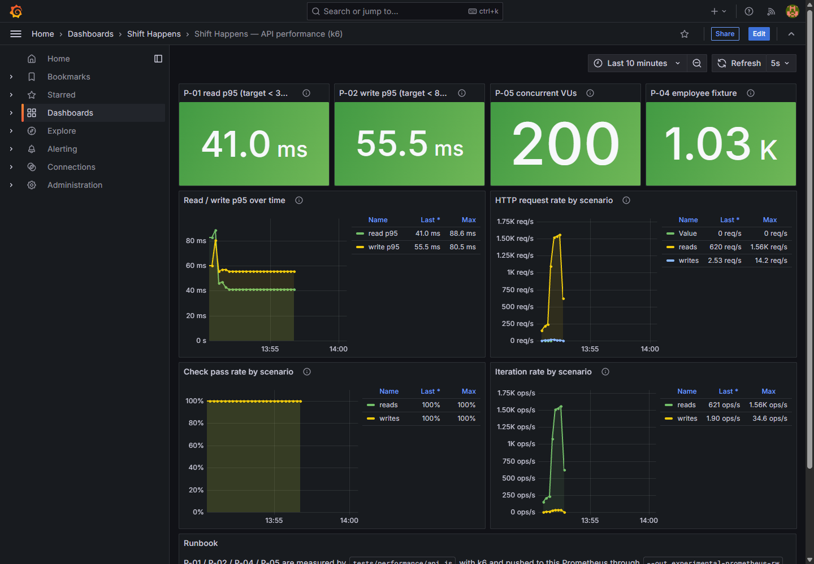

# Performance tests (k6)

This folder contains the k6 checks for the performance requirements that can be verified locally:

| Requirement | What the test measures |
|---|---|
| **P-01** | p95 of a representative authenticated read: the Scheduling GraphQL schedule query |
| **P-02** | p95 of a real authenticated write: `PATCH /api/v1/employees/{id}` |
| **P-04** | the employee read response contains at least **1,000** records |
| **P-05** | a sustained 200-VU read run with zero request failures |

P-03 (notification delivery within 5 seconds) is intentionally outside this suite.

## Prerequisites

- The Compose app is running and the gateway answers on `https://localhost:8443`.
- `k6` is on `PATH`.
- The 1,000-employee fixture is loaded once:

```powershell
Get-Content tests/performance/seed-performance.sql -Raw |
  docker compose -f docker-compose.microservices.yml exec -T workforce-db `
    psql -v ON_ERROR_STOP=1 -U workforce -d workforce
```

The fixture is local performance data. It writes directly to the Workforce write model and is not
application seed data or a Flyway migration.

## Run the baseline and send results to Grafana

Prometheus in `docker-compose.microservices.yml` has the remote-write receiver enabled:

```powershell
$env:PERF_BASE_URL = 'https://localhost:8443'
$env:K6_PROMETHEUS_RW_SERVER_URL = 'http://localhost:9090/api/v1/write'
# The receiver exports p99 by default; expose p95 for P-01/P-02.
$env:K6_PROMETHEUS_RW_TREND_STATS = 'p(95),p(99),avg,min,max'

# 50 read VUs + 10 write VUs for 60 seconds.
k6 run --out experimental-prometheus-rw tests/performance/api.js
```

Open the provisioned dashboard:

**http://localhost:3001/d/shift-happens-performance**

The dashboard shows P-01/P-02 p95, P-04 employee count, P-05 read VUs, throughput and failures.
The panels read the `k6_*` series from Prometheus; results are not a separate file.

## Run the P-05 200-user concurrency check

P-05 is a separate saturation run so its latency does not overwrite the P-01/P-02 baseline:

```powershell
$env:PERF_P05_ONLY = 'true'
$env:PERF_DURATION = '60s'
k6 run --out experimental-prometheus-rw tests/performance/api.js
```

This runs **200 read VUs plus one write VU**, with the same authenticated gateway and schedule read.
It checks request failures and records the 200-VU gauge for the Grafana P-05 panel. A P-05 run is not
a claim that P-01's 300 ms target still holds at saturation; the dashboard keeps the two profiles
separate (`profile="baseline"` and `profile="concurrency"`).

## Test design

- The test logs in once per k6 run and reuses the JWT across VUs. It is a concurrency test, not 200
  distinct user accounts.
- The read scenario uses the same GraphQL query as `scripts/load-schedule.mjs`.
- The write scenario PATCHes a distinct existing employee per writer, so writers do not contend on
  one row. Each PATCH is a real Workforce transaction and outbox write.
- The script validates P-04 before starting the load; it fails fast with a clear message if the
  1,000-employee fixture is missing.
- The local stack, databases and k6 share one workstation. Treat the results as local evidence, not
  as a production SLO.

## Measured local results

Baseline, 50 read VUs + 10 write VUs for 60 seconds:

| Check | Measured | Result |
|---|---:|---|
| P-01 GraphQL schedule p95 | **40.8 ms** | PASS (< 300 ms) |
| P-02 employee PATCH p95 | **55.5 ms** | PASS (< 800 ms) |
| P-04 employee fixture | **1,028** rows | PASS (≥ 1,000) |
| request failures | **0** | PASS |
| throughput | **149 req/s** | local evidence |

P-05 saturation, 200 read VUs + 1 write VU for 60 seconds:

| Check | Measured | Result |
|---|---:|---|
| concurrent read VUs | **200** | PASS |
| requests | **33,185** | 547 req/s |
| GraphQL schedule p95 | **43.0 ms** | PASS |
| failures | **0** | PASS |

These are local Docker Desktop measurements with one workstation hosting k6, Caddy, the services and
the databases. They are not a production SLO. P-01 uses the schedule read; the full 1,000-row employee
list is a capacity fixture, not the P-01 latency workload, because it returns the whole table.


